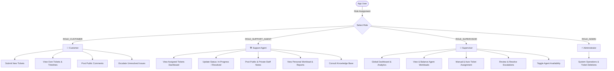
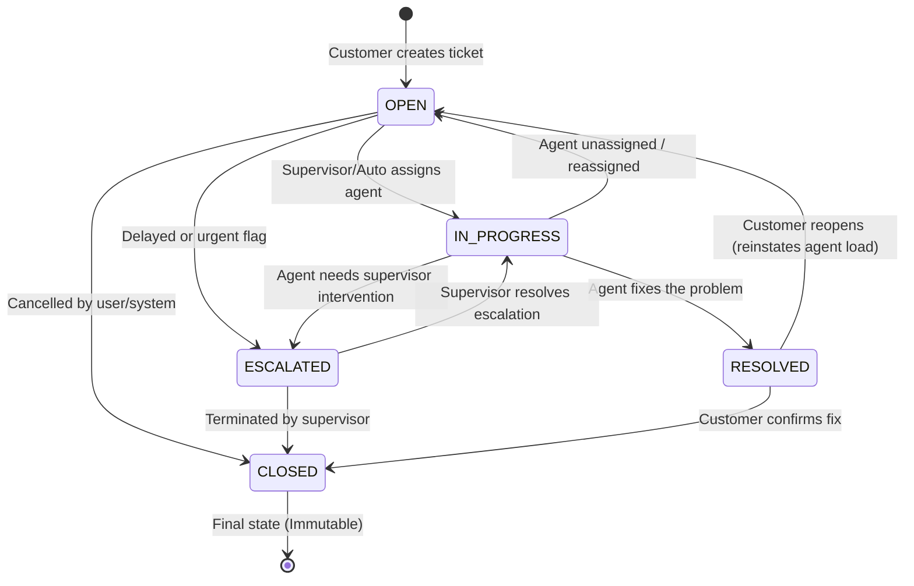
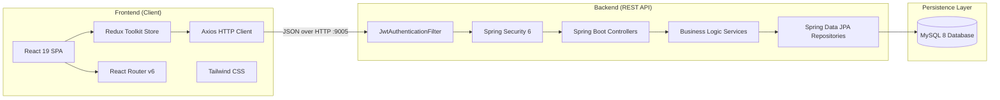
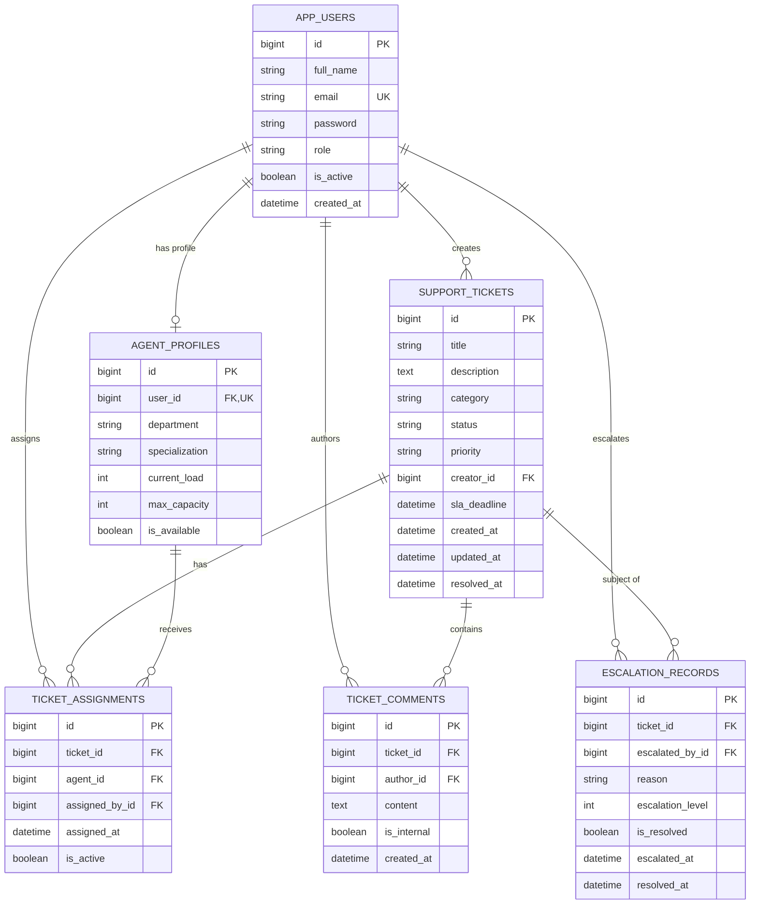

# 🎫 ZenDesk Minimalist Ticket Resolution Hub
### *A Complete, Beginner-Friendly Guide & Architectural Blueprint*

---

## 📖 Table of Contents
1. [Project Overview in Simple Words](#1-project-overview-in-simple-words)
2. [Why Was This Project Built? (The Problem & Solution)](#2-why-was-this-project-built-the-problem--solution)
3. [Real-World Analogy: How the System Works](#3-real-world-analogy-how-the-system-works)
4. [User Roles & Permissions (Who Can Do What?)](#4-user-roles--permissions-who-can-do-what)
5. [The Life of a Ticket (Lifecycle & State Machine)](#5-the-life-of-a-ticket-lifecycle--state-machine)
6. [Core Features & Smart Capabilities](#6-core-features--smart-capabilities)
7. [System Architecture & Technology Stack](#7-system-architecture--technology-stack)
8. [Database Schema & Data Model](#8-database-schema--data-model)
9. [REST API Endpoints Reference](#9-rest-api-endpoints-reference)
10. [Frontend User Interface & Experience](#10-frontend-user-interface--experience)
11. [Default Test Accounts & Credentials](#11-default-test-accounts--credentials)
12. [Step-by-Step Installation & Run Guide](#12-step-by-step-installation--run-guide)
13. [Key Takeaways & Summary](#13-key-takeaways--summary)

---

## 1. Project Overview in Simple Words

The **ZenDesk Minimalist Ticket Resolution Hub** is a full-stack web application designed to help businesses manage, track, and resolve customer support complaints (called **"Tickets"**) swiftly and without confusion.

Think of it like a smart digital customer service desk:
- When a customer runs into an issue with a product or service, they file a ticket.
- The system automatically stamps a deadline (SLA) on the ticket depending on how urgent it is.
- A supervisor or the system's auto-assignment engine gives the ticket to the agent with the lightest workload.
- The agent works on the problem, chats with the customer, notes down internal technical findings, and marks it resolved.
- If a problem is too tough or takes too long, it can be escalated to supervisors, automatically raising its priority so it gets urgent attention.

All of this happens inside a modern, futuristic dark-mode web dashboard featuring neon accents, charts, and real-time status tracking.

---

## 2. Why Was This Project Built? (The Problem & Solution)

### The Problem
Traditional customer support operations often suffer from critical issues:
1. **Missed Deadlines:** Urgent issues get lost in long email chains or messy spreadsheets.
2. **Agent Burnout & Uneven Work:** Some agents get overwhelmed with 20 difficult tickets while others have only 2.
3. **Customer Frustration:** Customers are left in the dark about who is solving their problem or what state it is in.
4. **No Escalation Path:** When a high-severity bug remains unsolved, there is no formal way to escalate it up the chain.
5. **Accidental Data Leaks:** Sensitive internal staff notes sometimes get accidentally sent to the customer.

### The Solution Provided by this Project
| Challenge | How This System Solves It |
| :--- | :--- |
| **Urgency Tracking** | Calculates a strict **Service Level Agreement (SLA)** deadline the second a ticket is submitted (e.g., Critical = 4 hours, Low = 72 hours). |
| **Fair Workload Distribution** | Tracks each agent's active load and capacity, offering **1-Click Auto-Assignment** to the least busy available agent. |
| **Total Transparency** | Customers see live status tags (`OPEN`, `IN_PROGRESS`, `RESOLVED`, `CLOSED`, `ESCALATED`) and assigned agent names. |
| **Smart Escalation Cascade** | Supports up to 3 escalation levels. When escalated multiple times, the system **automatically upgrades ticket priority** (e.g., Medium $\rightarrow$ High $\rightarrow$ Critical). |
| **Dual Commenting Channels** | Comments have an `isInternal` flag. Staff can make private technical notes that are completely hidden from customer accounts. |

---

## 3. Real-World Analogy: How the System Works

To understand the system without any programming jargon, imagine a **Hospital Emergency Room**:

```
[Patient Arrives] ─────────► [Triage Nurse] ─────────► [Doctor / Specialist] ────────► [Discharge / Follow-up]
Customer files ticket        Supervisor / Auto-Assign     Support Agent resolves          Ticket is Closed
with symptoms & severity     assigns to available doctor  issue & adds treatment notes
```

1. **The Patient (Customer)** walks in and reports an illness (**Creates a Ticket**). They state whether it is a mild headache (**Low Priority**) or severe chest pain (**Critical Priority**).
2. **The Triage Nurse (Supervisor / Auto-Assignment Engine)** evaluates the room. They find a doctor who currently has the fewest patients and assigns them the case.
3. **The Doctor (Support Agent)** diagnoses the issue, writes medical notes for the hospital staff (**Internal Comments**), and explains the medicine to the patient (**Public Comments**).
4. **Specialist Call (Escalation):** If the condition is unusually complex, the doctor calls the Head of Medicine (**Supervisor Escalation**), automatically raising the emergency level.
5. **Discharge (Resolution):** Once treated, the patient is discharged (**Ticket Resolved / Closed**), freeing up that doctor to accept another patient (**Workload Decreases**).

---

## 4. User Roles & Permissions (Who Can Do What?)

The application uses **Role-Based Access Control (RBAC)** powered by Spring Security. There are 3 primary daily roles (plus a system Administrator role):



### Detailed Role Matrix

| Action / Permission | Customer | Support Agent | Supervisor | Admin |
| :--- | :---: | :---: | :---: | :---: |
| **Register & Login** | ✅ | ✅ | ✅ | ✅ |
| **Create Support Ticket** | ✅ | ❌ | ❌ | ❌ |
| **View Own Submitted Tickets** | ✅ | ❌ | ❌ | ❌ |
| **View Assigned Tickets** | ❌ | ✅ | ❌ | ❌ |
| **View ALL System Tickets** | ❌ | ❌ | ✅ | ✅ |
| **Update Ticket Status (In Progress / Resolved)** | ❌ | ✅ | ✅ | ❌ |
| **Assign or Reassign Tickets** | ❌ | ❌ | ✅ | ❌ |
| **Use 1-Click Auto Assignment** | ❌ | ❌ | ✅ | ❌ |
| **Post Public Comments** | ✅ | ✅ | ✅ | ❌ |
| **Post Internal (Hidden) Notes** | ❌ | ✅ | ✅ | ❌ |
| **Escalate a Ticket** | ✅ | ✅ | ✅ | ❌ |
| **Resolve an Escalation** | ❌ | ❌ | ✅ | ❌ |
| **Monitor Agent Capacities & Workloads** | ❌ | ❌ | ✅ | ❌ |
| **Toggle Agent Availability Status** | ❌ | ❌ | ✅ | ❌ |
| **Delete Ticket Record** | ❌ | ❌ | ❌ | ✅ |

---

## 5. The Life of a Ticket (Lifecycle & State Machine)

Every ticket moves through an orderly progression of statuses. The backend code enforces **strict transition rules** to prevent accidental or illogical state jumps (for example, you cannot jump from `OPEN` straight to `RESOLVED` without an agent taking it into `IN_PROGRESS` first).



### Valid Transition Matrix

| From Current Status | Allowed Next Statuses | Business Logic Trigger |
| :--- | :--- | :--- |
| **`OPEN`** | `IN_PROGRESS`, `CLOSED`, `ESCALATED` | When assigned to an agent, moves to `IN_PROGRESS`. |
| **`IN_PROGRESS`** | `RESOLVED`, `ESCALATED`, `OPEN` | When marked `RESOLVED`, the assigned agent's current load is decremented by 1. |
| **`ESCALATED`** | `IN_PROGRESS`, `CLOSED` | When supervisor resolves the escalation, it safely reverts back to `IN_PROGRESS`. |
| **`RESOLVED`** | `CLOSED`, `OPEN` | If reopened (`RESOLVED` $\rightarrow$ `OPEN`), the agent's load is incremented by 1 again. |
| **`CLOSED`** | *None (Terminal)* | Closed tickets cannot receive new comments or status updates. |

---

## 6. Core Features & Smart Capabilities

### 1. ⏱️ Automated SLA (Service Level Agreement) Engine
The system calculates a firm completion deadline the moment a ticket is saved, strictly based on its priority:
- 🔴 **CRITICAL:** Deadline is set to **now + 4 hours**.
- 🟠 **HIGH:** Deadline is set to **now + 12 hours**.
- 🟡 **MEDIUM:** Deadline is set to **now + 24 hours**.
- 🟢 **LOW:** Deadline is set to **now + 72 hours**.

The frontend highlights tickets approaching or exceeding their SLA in amber and rose colors to ensure no urgent ticket slips through unnoticed.

### 2. ⚖️ Fair Load-Balancing & Auto-Assignment
Each support agent has a profile tracking:
- `currentLoad`: How many active tickets they are currently working on.
- `maxCapacity`: The maximum number of tickets they can handle at once (default: 5).
- `isAvailable`: Whether the agent is on shift or away.

When the supervisor clicks **"Auto Assign"**, the backend executes a database query:
```sql
SELECT a FROM AgentProfile a 
WHERE a.isAvailable = true AND a.currentLoad < a.maxCapacity 
ORDER BY a.currentLoad ASC
```
It immediately assigns the ticket to the agent with the lowest load, increments their active count, and moves the ticket from `OPEN` to `IN_PROGRESS`.

### 3. 🚨 Multi-Level Escalation & Priority Bumping
If a customer's issue is blocked or taking too long:
- Any authorized user can escalate the ticket with an explanation reason.
- The system allows up to **3 escalation levels**.
- **Automatic Priority Bump:** If a ticket reaches Escalation Level 2 or 3 and is not already Critical, its priority is automatically upgraded:
  $$\text{LOW} \longrightarrow \text{MEDIUM} \longrightarrow \text{HIGH} \longrightarrow \text{CRITICAL}$$
- Supervisors have a dedicated screen to review open escalations, coordinate solutions, and click **"Resolve Escalation"**.

### 4. 💬 Two-Way Communication with Private Staff Notes
The commenting system supports two conversation streams in one unified timeline:
- **Public Comments (`isInternal = false`):** Messages exchanged between the customer and the support staff.
- **Internal Staff Notes (`isInternal = true`):** Private technical commentary between agents and supervisors (e.g., *"Database query timed out on replica #3; engineering investigating"*).
- **Security Check:** Even if a customer inspects network requests or calls the API directly, the backend filters out internal comments before returning the JSON payload.

### 5. 📊 Interactive Visual Analytics
- **Stat Cards:** Real-time metrics showing total tickets, open queue, in-progress count, resolved tally, and escalation rate.
- **Dynamic Charts:** Visual breakdown of ticket volume by current status.
- **Agent Workload Monitor:** Visual progress bars displaying each agent's current load percentage ($0\% - 100\%$) and shift availability status.
- **Knowledge Base:** Fast searchable troubleshooting articles for common customer support scenarios.

---

## 7. System Architecture & Technology Stack

The project is built as a modern, decoupled client-server web application:



### Technology Breakdown

| Component | Technology | Version | Purpose in Project |
| :--- | :--- | :--- | :--- |
| **Backend Framework** | Spring Boot | `3.2.5` | RESTful API service, dependency injection, and application lifecycle. |
| **Language (Backend)** | Java | `17` | Strongly typed object-oriented server implementation. |
| **Security** | Spring Security + JJWT | `0.11.5` | Stateless authentication, bcrypt password hashing, and role-based route guard. |
| **Database ORM** | Spring Data JPA / Hibernate | Latest | Object-relational mapping, automatic schema synchronization, query abstraction. |
| **Database** | MySQL | `8.x` | Persistent relational storage for users, tickets, assignments, comments, escalations. |
| **API Documentation**| Springdoc OpenAPI | `2.5.0` | Interactive Swagger UI for testing API endpoints (`/swagger-ui.html`). |
| **Frontend Framework**| React | `19.2.5` | Declarative component-based UI layer. |
| **State Management** | Redux Toolkit (`@reduxjs/toolkit`)| `2.13.0` | Centralized global state for auth tokens, tickets, agents, and comments. |
| **Routing** | React Router DOM | `6.30.6` | Client-side routing, protected route guards, and URL navigation. |
| **Styling** | Tailwind CSS | `3.4.19` | Modern dark-mode cyberpunk design styling with custom color gradients. |
| **HTTP Client** | Axios | `1.20.0` | Asynchronous communication with interceptors for automatic JWT attachment. |

---

## 8. Database Schema & Data Model

The application uses an efficient relational structure designed with data integrity, foreign key references, and cascade rules.



---

## 9. REST API Endpoints Reference

All API routes (except public auth and Swagger documentation) require a valid JWT token sent in the `Authorization: Bearer <TOKEN>` header.

### 🔐 Authentication Controller (`/api/auth`)
| Method | Endpoint | Access | Description |
| :--- | :--- | :--- | :--- |
| `POST` | `/api/auth/register` | Public | Register a new customer account. |
| `POST` | `/api/auth/login` | Public | Login with email and password to receive a JWT token and user profile. |

### 🎫 Ticket Controller (`/api/tickets`)
| Method | Endpoint | Allowed Roles | Description |
| :--- | :--- | :--- | :--- |
| `POST` | `/api/tickets` | `ROLE_CUSTOMER` | Submit a new support ticket. |
| `GET` | `/api/tickets` | All Authenticated | Fetch tickets (auto-filtered: Customer gets own tickets; Agent gets assigned tickets; Supervisor gets all). |
| `GET` | `/api/tickets/{id}` | All Authenticated | Fetch complete details of a specific ticket by ID. |
| `PUT` | `/api/tickets/{id}/status` | `ROLE_SUPPORT_AGENT`, `ROLE_SUPERVISOR` | Update ticket status following valid transition rules. |
| `GET` | `/api/tickets/status/{status}` | `ROLE_SUPPORT_AGENT`, `ROLE_SUPERVISOR` | Filter tickets by status (`OPEN`, `IN_PROGRESS`, etc.). |
| `DELETE`| `/api/tickets/{id}` | `ROLE_ADMIN` | Permanently remove a ticket record. |

### 🤝 Ticket Assignment Controller (`/api/assignments`)
| Method | Endpoint | Allowed Roles | Description |
| :--- | :--- | :--- | :--- |
| `POST` | `/api/assignments/assign` | `ROLE_SUPERVISOR` | Manually assign a ticket to a specific agent. |
| `POST` | `/api/assignments/auto/{ticketId}` | `ROLE_SUPERVISOR` | Automatically assign ticket to the least-loaded available agent. |
| `DELETE`| `/api/assignments/{ticketId}` | `ROLE_SUPERVISOR` | Unassign agent from ticket; resets status back to `OPEN`. |

### ⚡ Escalation Controller (`/api/escalations`)
| Method | Endpoint | Allowed Roles | Description |
| :--- | :--- | :--- | :--- |
| `POST` | `/api/escalations` | Customer, Agent, Supervisor | Escalate a ticket with a stated reason. |
| `PUT` | `/api/escalations/{id}/resolve` | `ROLE_SUPERVISOR` | Mark escalation as resolved and return ticket to `IN_PROGRESS`. |
| `GET` | `/api/escalations/ticket/{ticketId}`| `ROLE_SUPPORT_AGENT`, `ROLE_SUPERVISOR` | List all escalation records for a specific ticket. |
| `GET` | `/api/escalations` | `ROLE_SUPERVISOR` | List all escalations across the entire system. |
| `GET` | `/api/escalations/unresolved` | `ROLE_SUPERVISOR` | View all active pending escalations requiring attention. |

### 💬 Comment Controller (`/api/tickets/{ticketId}/comments`)
| Method | Endpoint | Allowed Roles | Description |
| :--- | :--- | :--- | :--- |
| `POST` | `/api/tickets/{ticketId}/comments` | Customer, Agent, Supervisor | Add comment (Customer comments are forced to `isInternal=false`). |
| `GET` | `/api/tickets/{ticketId}/comments` | Customer, Agent, Supervisor | Retrieve comments (internal comments automatically stripped for customers). |
| `DELETE`| `/api/tickets/{ticketId}/comments/{commentId}` | Author, Supervisor | Delete a specific comment. |

### 👨‍💼 Agent Profile Controller (`/api/agents`)
| Method | Endpoint | Allowed Roles | Description |
| :--- | :--- | :--- | :--- |
| `GET` | `/api/agents` | `ROLE_SUPERVISOR` | List all registered agents and their current statistics. |
| `GET` | `/api/agents/workload` | `ROLE_SUPERVISOR` | List agents sorted from highest to lowest workload percentage. |
| `GET` | `/api/agents/{id}` | Agent, Supervisor | Retrieve a single agent profile. |
| `PUT` | `/api/agents/{id}/toggle-availability`| `ROLE_SUPERVISOR` | Toggle agent between Available (active) and Unavailable (off-shift). |
| `POST` | `/api/agents/{id}/recalculate` | `ROLE_SUPERVISOR` | Sync agent load counter with real active assignments in database. |

---

## 10. Frontend User Interface & Experience

The user interface is crafted with a high-end, futuristic **Cyberpunk Dark Theme** designed to make prolonged ticket triaging comfortable for support teams:

1. **Vibrant Palette:** Deep obsidian-indigo backgrounds (`#0b071b`, `#1a0b2e`) paired with cyan, electric pink, and emerald status badges.
2. **Role-Tailored Navbars:** 
   - Customers only see: *My Tickets* and *New Ticket*.
   - Agents see: *Dashboard*, *My Tickets*, *Escalations*, *Knowledge Base*, *Reports*, and *Profile*.
   - Supervisors see: *Dashboard*, *All Tickets*, *Agent Workload*, and *System Escalations*.
3. **Animated Timelines:** Shows the ticket progression step-by-step from creation $\rightarrow$ assignment $\rightarrow$ resolution.
4. **Illustrated Avatars:** Deterministic SVG illustrated avatars generated automatically based on agent names.
5. **Integrated JWT Interceptor:** Axios automatically attaches the saved token to every outgoing call and smoothly logs the user out if their session expires.

---

## 11. Default Test Accounts & Credentials

The backend includes an automatic **Data Seeder** (`DataSeeder.java`). The very first time the database starts up, it automatically creates these three test accounts:

| User Type | Email Address | Password | Role Key | What to Test |
| :--- | :--- | :--- | :--- | :--- |
| **Supervisor** | `supervisor@test.com` | `password123` | `ROLE_SUPERVISOR` | View all tickets, auto-assign agents, resolve escalations, inspect workload charts. |
| **Support Agent** | `agent@test.com` | `password123` | `ROLE_SUPPORT_AGENT` | View assigned tickets, post private staff notes, resolve tickets, view personal reports. |
| **Customer** | `customer@test.com` | `password123` | `ROLE_CUSTOMER` | Create new tickets, track resolution progress, chat with the agent, escalate delayed tickets. |

---

## 12. Step-by-Step Installation & Run Guide

### Prerequisites
Make sure your computer has the following tools installed:
- **Java Development Kit (JDK 17 or higher)**
- **Node.js (v18 or higher) & npm**
- **MySQL Server (v8.0 or higher)**

---

### Step 1: Set Up the Database
Open MySQL Workbench, command line, or terminal, and create the database:
```sql
CREATE DATABASE zendesk_db;
```
*(Hibernate will automatically create all tables, indexes, and foreign keys when the backend starts).*

Check your database credentials in:
`backend/src/main/resources/application.properties`:
```properties
spring.datasource.url=jdbc:mysql://localhost:3306/zendesk_db?createDatabaseIfNotExist=true
spring.datasource.username=root
spring.datasource.password=YOUR_MYSQL_PASSWORD
server.port=9005
```

---

### Step 2: Run the Spring Boot Backend
Open a terminal in the `backend` folder:
```bash
cd backend
./mvnw clean spring-boot:run
```
*(On Windows Command Prompt, use `mvnw spring-boot:run`)*.

The backend will start on **port 9005**. You can test that it is running by opening the Swagger UI in your browser:
👉 [http://localhost:9005/swagger-ui.html](http://localhost:9005/swagger-ui.html)

---

### Step 3: Run the React Frontend
Open another terminal in the `frontend` folder:
```bash
cd frontend
npm install
npm start
```
The React development server will start on [http://localhost:3000](http://localhost:3000).

---

### Step 4: Verify the Entire Flow in 5 Minutes
1. Go to [http://localhost:3000/login](http://localhost:3000/login).
2. Log in as **`customer@test.com`** / **`password123`**.
   - Click **New Ticket**. Fill in: Title = *"Payment Gateway Bug"*, Category = *"Billing"*, Priority = *"Critical"*. Submit.
   - Notice the SLA deadline is automatically set to 4 hours from now.
3. Log out and log in as **`supervisor@test.com`** / **`password123`**.
   - Go to **All Tickets**. You will see the new ticket in `OPEN` state.
   - Click **Auto Assign**. Notice the ticket moves to `IN_PROGRESS` and John Agent is assigned.
   - Go to **Agent Workload** to see John Agent's load counter incremented to `1/5 (20%)`.
4. Log out and log in as **`agent@test.com`** / **`password123`**.
   - Go to **My Tickets**. Open the ticket.
   - Add an Internal Note: *"Checking payment logs on Stripe webhook"*.
   - Add a Public Comment: *"Hello Jane, we are verifying your payment record right now."*
   - Change Status to **RESOLVED**.
5. Log back in as **`customer@test.com`**:
   - You will see the public comment, but the internal staff note is completely invisible.
   - The ticket status proudly shows **RESOLVED**!

---

## 13. Key Takeaways & Summary

- **Complete Enterprise Pattern:** Combines modern frontend design with industrial-strength backend engineering (REST, JWT, RBAC, JPA, MySQL).
- **Business Logic Enforced Server-Side:** Status transitions, SLA calculation, load calculations, and escalation cascades are handled in robust Spring services, making it impossible for unauthorized clients to corrupt data.
- **Fair & Automated:** Agents are never overloaded thanks to built-in load balancing, and supervisors can oversee the entire operation through a single control hub.
- **Production-Ready Foundations:** Includes CORS protection, password encryption, global exception handling, and self-documenting OpenAPI specifications.
